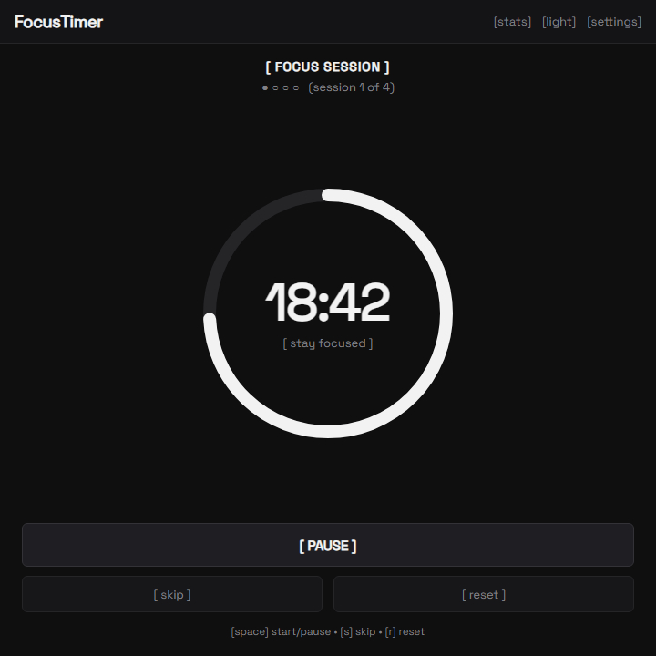
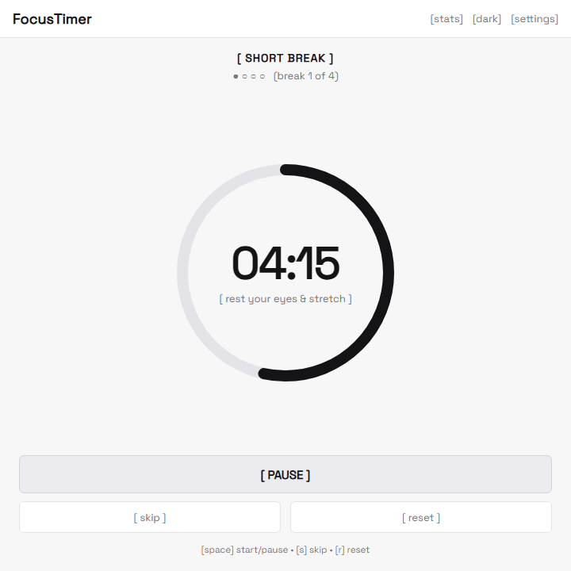
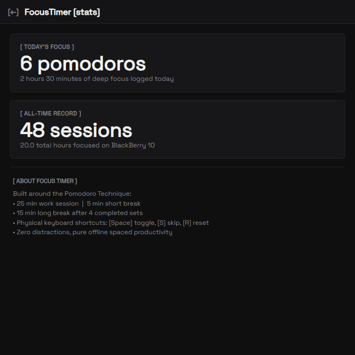

# FocusTimer (BB10)

> A distraction-free Pomodoro & focus timer app built specifically for BlackBerry 10 devices (Q10, Q5, Classic, Passport) running the Android 4.3 runtime (API 18). Styled with the **Space Grotesk** typography and a minimalist monotone aesthetic.

<p align="center">
  
  &nbsp;
  
  &nbsp;
  
</p>
<p align="center"><em>Focus Mode (Dark) &nbsp;&bull;&nbsp; Break Mode (Light) &nbsp;&bull;&nbsp; Session Stats</em></p>

---

## ⚡ Features

- ⏱️ **Full Pomodoro Cycle Engine**:
  - Focus session (default 25m, customizable 1–90m)
  - Short break (default 5m, customizable 1–30m)
  - Long break (default 15m, customizable 1–60m)
  - Configurable long break interval (e.g., every 4 focus sets)
  - Interactive cycle progress dots: `● ● ○ ○ (session 2 of 4)`
- ⭕ **Circular Progress Countdown**: Custom hardware-accelerated ring indicator with crisp countdown numerals.
- ⌨️ **BlackBerry Physical Keyboard Shortcuts**:
  - `[Space]` — Start / Pause / Resume
  - `[S]` — Skip to next phase (Break / Focus)
  - `[R]` — Reset current timer
  - `[T]` — Toggle Light / Dark monochrome theme
- 🔔 **Haptic & Sound Alerts**: Built-in chime tones via `ToneGenerator` and double-pulse haptic vibration when sessions finish.
- 📊 **Productivity Statistics**: Tracks today's completed pomodoros, minutes focused, and all-time total hours.
- 🌗 **Monochrome Design**: Pure grayscale minimal palette with instant `[light]` / `[dark]` toggle.
- 🔤 **Space Grotesk Typography**: Custom embedded font styled after minimalist typographic web design.
- 🔋 **Zero Bloat & Battery Friendly**: Pure Java API 18 implementation, zero AndroidX or heavy background services.

---

## 📲 Sideloading onto BlackBerry 10

1. Download **`FocusTimer.apk`**.
2. Transfer it to your BlackBerry via USB or copy directly onto your MicroSD card.
3. Open the **File Manager** app on your BB10 device.
4. Tap `FocusTimer.apk` and tap **Install** in the top-right corner.

---

## 🏗️ Building from Source

Requirements: Android SDK, JDK 17

```bash
./gradlew assembleDebug
```

The APK will be generated at:
`app/build/outputs/apk/debug/app-debug.apk`
